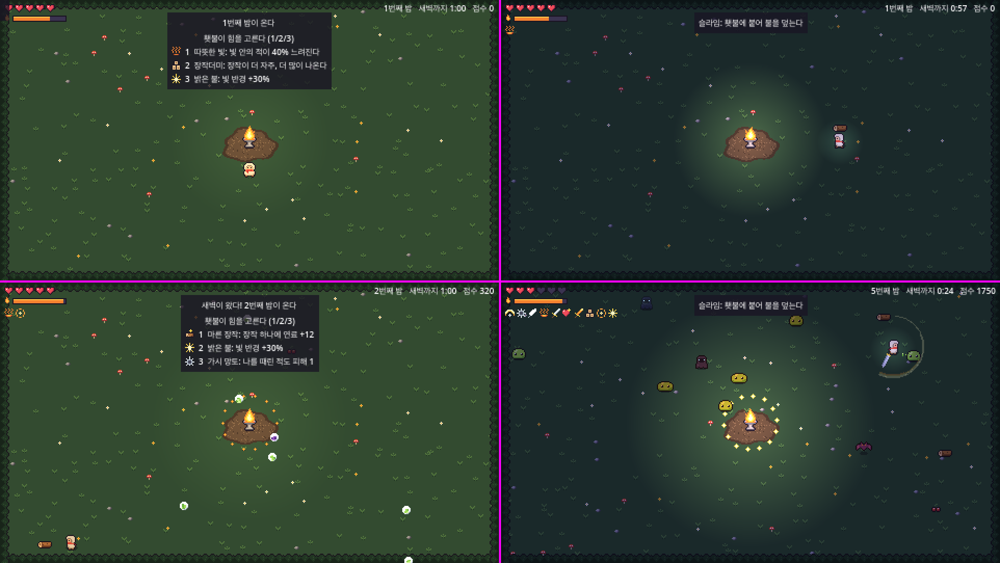

# 횃불 지기

밤마다 꺼져 가는 횃불을 지키는 상단 시점 생존 게임입니다. 장작을 주워 횃불에 넣고, 어둠에서 나오는 것들과 싸우세요.
새벽이 올 때마다 더 어려운 밤이 시작되고 새로운 적이 나옵니다. Godot 4 (GDScript)로 만들었습니다.



## 규칙

- 횃불은 계속 연료를 태웁니다. **연료가 0이 되거나 체력이 0이 되면** 끝입니다.
- 장작에 닿으면 줍습니다. 장작을 횃불에 가져가면 연료가 채워집니다. 장작을 든 동안은 느리고 벨 수 없습니다.
- 한 밤은 60초입니다. 새벽까지 버티면 점수 +100, 체력 +1을 받고 다음 밤으로 넘어갑니다. 승리는 없습니다. 몇 번째 밤까지 갔는지와 점수가 결과입니다.
- 기사는 밤이 깊을수록 단단해집니다: 10번째 밤에 하트 3개, 12·14·16번째 밤에 하나씩 더(최대 6개 더), 10번째 밤부터는 새벽에 체력이 모두 회복되고, 맞은 뒤 무적 시간이 밤마다 0.15초씩 길어집니다(1.2초에서 최대 2.4초).
- 해 질 녘과 한밤중에 횃불이 강화 3개를 내밉니다. 1·2·3 키, ← → 와 Enter, 또는 클릭으로 하나를 고르세요(강화는 17종, 여러 번 골라 단계를 올릴 수 있는 것도 있습니다).
- 점수: 처치 10점, 장작 5점, 새벽 100점.

### 캐릭터

판을 시작할 때(첫 화면 안내의 "시작" 뒤, 그리고 R이나 끝 화면을 눌러 다시 할 때마다) 횃불을 지킬 사람을 셋 중에서 고릅니다. 셋 다 처음부터 고를 수 있고, 지난번에 고른 카드에 초점이 가 있어서 Enter나 같은 카드를 누르면 바로 이어 갑니다. 카드를 누르거나 클릭, 1·2·3 키, ← → 와 Enter로 고릅니다(열린 뒤 0.6초는 누르는 것을 받지 않습니다).


| 캐릭터 | 공격 | 특징 | 약점 |
|---|---|---|---|
| 기사 | 칼: 0.28초마다 휘두르기, 피해 1 | 지금까지의 기사 그대로. 체력 5 | 없음 |
| 나무꾼 | 도끼: 0.38초마다, 피해 2, 더 넓게(양쪽 90°), 1.2배 더 밀어냄 | 장작을 셋까지 한꺼번에 들고(하나 더 들 때마다 조금 느려짐: 초당 70 → 64 → 58), 횃불에 넣으면 전부 들어갑니다. 장작 하나에 연료 +5. 도둑은 쌓인 장작 중 하나만 훔쳐 가고, 베기 키는 든 장작을 전부 내려놓습니다 | 느린 휘두르기(맞는 순간이 0.13초 뒤) |
| 불씨 술사 | 불씨: 0.68초마다 겨눈 쪽(가장 가까운 적)으로 쏘기. 초당 200픽셀로 100픽셀까지 날아가 처음 닿은 적에게 피해 1. 멈춘 자리에서 터져 반경 16픽셀 안의 다른 적에게도 피해 1. 날아가는 불씨와 터짐은 둘레의 어둠을 밝힙니다(보는 데만 쓰이고, 빛 보너스는 횃불 빛에서만) | 횃불 빛 안의 적에게는 피해 +1, 그 적을 꿰뚫고 하나 더 맞힙니다(빛을 키우는 강화와 잘 맞습니다) | 체력 3, 장작을 들면 느림(초당 50) |

칼 강화는 캐릭터에 맞게 바뀝니다. 나무꾼에게는 긴 도끼자루·넓은 휘두르기·불붙은 도끼·흡혈 도끼, 불씨 술사에게는 먼 불씨(날아가는 거리 +30/+50), 큰 불씨(맞히는 반경 +2/+3.5), 세 갈래 불씨(세 번째/두 번째 쏠 때마다 셋을 부채꼴로), 타오르는 불씨, 흡혈 불씨입니다. 끝 화면과 최고 기록에 캐릭터 이름이 함께 나옵니다.

### 적

| 적 | 하는 일 |
|---|---|
| 슬라임 | 횃불에 붙어 불을 덮습니다(연료가 빨리 줄어듦) |
| 박쥐 | 기사를 쫓아옵니다. 횃불 빛 밖에서는 더 빠릅니다(눈이 빨갛게 탑니다) |
| 도둑 비버 | 장작을 물고 달아납니다. 닿아도 다치지 않습니다 |
| 그림자 | 횃불 빛 밖에서는 칼이 통하지 않습니다. 빛 안으로 끌어들이세요 |
| 큰 슬라임 | 느리고 단단합니다. 죽으면 슬라임 둘로 갈라집니다 |
| 멧돼지 | 기사를 쫓다가 멈춰 서서 발을 구르며 돌진할 길에 빨간 띠를 깔고, 띠가 차오르는 약 0.8초 뒤 그 띠를 따라 곧장 돌진합니다. 띠의 너비가 돌진에 맞는 너비라서 띠 밖에 서 있으면 안전합니다. 돌진이 끝나면 잠시 어지러워합니다(머리 위에 별). 그때 베세요 |

2번째 밤부터 도둑, 3번째 밤부터 그림자, 4번째 밤부터 큰 슬라임, 6번째 밤부터 멧돼지가 나옵니다. 7번째 밤부터는 적이 무리로도 옵니다: 도둑은 지켜 주는 그림자와, 멧돼지는 곁의 박쥐와 함께 같은 가장자리에서 나옵니다(9번째 밤에는 큰 슬라임이 멧돼지를 데려옵니다). 밤이 깊어질수록 적이 자주 오고 횃불이 빨리 타지만, 장작도 그만큼 자주 떨어집니다. 열매를 먹으면 체력이 1 회복됩니다.

8번째 밤부터는 같은 적이 더 센 등급으로도 나옵니다. 색으로 구별합니다: 슬라임은 초록 → 주황 → 빨강, 박쥐는 보라 → 황금 → 빨강, 그림자는 보라 → 청록 → 빨강, 도둑 비버와 멧돼지는 갈색 → 잿빛 → 빨강. 2등급은 체력 1.5배·10% 빠르고, 3등급(빨강)은 체력 2배·20% 빠르며 칼에 덜 밀립니다. 횃불을 덮는 힘과 처치 점수도 등급을 따라 커집니다. 12번째 밤부터 빨간 적이 섞이고, 깊은 밤일수록 많아집니다. 보스는 등급이 없습니다.


화면 밖(가장자리 나무 그늘)에서 들어오는 적은 그쪽 가장자리의 작은 흰 화살표로 보입니다.

3번째 밤마다 보스가 옵니다: 3·6·9번째 밤에는 하나, 12·15·18번째 밤에는 둘, 21번째 밤부터는 셋. 여럿일 때는 종류가 섞이고 6초 간격으로 하나씩 옵니다. 각 보스가 오기 2초 전에 나타날 화면 가장자리가 빨갛게 깜빡입니다. 첫 보스(3번째 밤)는 체력도 부르는 수도 절반이고, 보스 밤이 지날수록 세집니다(밤마다 +20%, 최대 1.5배). 화면 아래에 보스마다 이름과 체력 막대가 쌓입니다.

| 보스 | 하는 일 |
|---|---|
| 슬라임 왕 (3, 9, 15, ...번째 밤) | 횃불로 가며 슬라임을 부릅니다. 가까이 가면 기사가 선 자리에 빨간 원을 그리고 약 1초 뒤 그 위로 떨어집니다. 원 밖으로 피하세요. 두 번에 한 번은 크게 뛰는 대신 작은 원을 그리며 세 번 연달아 기사 쪽으로 깡충 뜁니다. 원마다 비키세요. 쓰러뜨리면 큰 슬라임으로 갈라집니다 |
| 그림자 군주 (6, 12, 18, ...번째 밤) | 횃불 빛 바로 밖을 돌며 그림자를 부릅니다. 어둠 속에서는 칼이 통하지 않습니다. 이따금 멈춰 횃불까지 점선을 긋고 1초 뒤 달려들어 잠시 불을 덮습니다. 빛 안에 있는 그때 베세요. 이따금 멈춰 깜빡이고 분신 둘을 만듭니다. 분신은 왕관이 없고 눈이 흐립니다(진짜는 파란 눈). 분신은 때리지도 불을 덮지도 않고, 군주가 달려들 때 같이 달려들다 횃불에서 흩어집니다. 빛 안에서 베면 흩어지지만 점수는 없습니다 |


## 조작

| 키 | 동작 |
|---|---|
| WASD / 방향키 | 이동 |
| Space / J / X | 베기, 불씨 술사는 쏘기 (장작을 들고 있으면 내려놓기) |
| Shift / K | 돌진 (돌진 강화가 있을 때. 다시 쓸 수 있을 때까지 기사 발밑에 막대가 차오릅니다) |
| 1 / 2 / 3 (또는 카드 클릭) | 캐릭터·강화 고르기 (← → 또는 A D로 카드를 옮기고 Enter·Space로도. 카드가 뜬 뒤 0.6초는 화살표와 Enter·Space를 받지 않습니다) |
| R | 다시 하기 |
| P / Esc | 일시정지 (가진 강화의 이름과 효과 목록) |
| H | 첫 화면의 안내 다시 보기 (게임을 열면 뜨는 세 쪽짜리 안내. ← → 로 넘기고 Enter 또는 Space로 시작) |

게임은 캐릭터 고르기, 그다음 강화 선택 화면에서 시작합니다. 먼저 1·2·3 중 하나를 눌러야 움직일 수 있습니다.

가진 강화는 왼쪽 위에 타일로 보입니다. 윗줄은 횃불의 힘(주황), 아랫줄은 기사의 힘(파랑)이고, 타일 아래 칸이 단계(채워진 금색 칸 = 지금 단계, 빈 칸 = 더 올릴 수 있는 단계)이며 마지막 단계면 테두리가 금색입니다. 이름과 효과는 고른 직후 위 가운데에 잠깐, 그리고 일시정지 화면과 끝 화면에 나옵니다. 땅에 떨어진 장작(금색 테두리)과 열매(흰 테두리)는 어둠 속에서도 테두리가 빛나고 가끔 반짝입니다. 횃불 빛 밖은 거의 캄캄합니다. 어둠 속의 적은 눈빛으로만 보이고, 빛 안에서는 모두 횃불 반대쪽으로 긴 그림자를 드리웁니다. 기사는 횃불에 닿으면 불씨를 붙여 갑니다. 불씨는 빛 밖에서 10초쯤에 걸쳐 식으면서 보이는 범위가 줄고, 횃불에 다시 닿아야 살아납니다(보는 데만 쓰이고, 적에게는 횃불 빛만 빛입니다).

## 실행

[Godot 4.7](https://godotengine.org/download)이 필요합니다. Windows에서는 이렇게 설치할 수 있습니다.

```
winget install GodotEngine.GodotEngine
```

```
godot --path .                    # 게임 실행
godot -e --path .                 # 에디터로 열기
godot --path . -- --bot           # 봇이 플레이하는 것 보기
godot --path . -- --seed=4        # 다른 밤(시드)으로 시작
godot --path . -- --bot --skip=19000  # 봇이 먼저 그만큼(스텝) 플레이한 뒤부터 보기
godot --path . -- --bot --slot=2  # 봇이 늘 고르는 강화 칸
godot --path . -- --char=mage     # 캐릭터 고르기 없이 그 캐릭터로 (knight, woodcutter, mage; 봇과 함께도)
```

## 웹/모바일

휴대폰이나 PC 브라우저에서 바로 할 수 있습니다: **https://khwook.github.io/2dgame1/** (GitHub Pages, `main`에 올라갈 때마다 다시 빌드). 휴대폰은 가로로 들고 하세요. 세로로 들면 게임이 멈추고 "가로로 돌려 주세요"가 뜹니다. 안드로이드 브라우저에서는 첫 화면 안내의 "시작"을 누르면 전체 화면으로 바뀝니다(아이폰 Safari는 웹 페이지의 전체 화면을 지원하지 않아서 그대로입니다. 공유 → "홈 화면에 추가"로 열면 주소창 없이 열립니다).


| 터치 | 동작 |
|---|---|
| 화면 왼쪽 아무 데나 누르고 끌기 | 이동 (손가락이 닿은 자리에 조이스틱이 나타납니다. 민 방향 그대로, 조금만 밀어도 제 속도로 걷습니다) |
| 오른쪽 아래 큰 칼 버튼, 또는 화면 오른쪽 아무 데나 | 베기 (장작을 들고 있으면 내려놓기). 이동하면서 같이 누를 수 있습니다 |
| 칼 버튼 왼쪽 버튼 | 돌진 (돌진 강화를 얻은 뒤에만 보입니다) |
| 오른쪽 위 ‖ 버튼 | 일시정지. 아무 데나 누르면 계속 |
| 그 왼쪽 ? 버튼 | 첫 화면(설명) 다시 보기. 일시정지 화면에서도 됩니다 (키보드의 H) |
| 첫 화면 안내 | 아무 데나 누르거나 옆으로 밀어 넘기고, 마지막 쪽의 "시작"으로 시작 (한 번 읽은 뒤에는 첫 쪽에도 "시작"). 열린 뒤 1초는 누르는 것을 받지 않습니다 |
| 끝 화면을 누르기 | 다시 하기 |
| 카드 누르기 | 캐릭터·강화 고르기 |

터치 버튼은 화면을 처음 만졌을 때(또는 터치 화면이 있는 기기에서) 나타나고, 키보드를 누르면 사라집니다. 웹에서도 키보드로 할 수 있습니다.

배포를 켜려면 저장소 주인이 한 번 **Settings → Pages → Source: GitHub Actions**로 바꿔야 합니다(`.github/workflows/pages.yml`). 비공개 저장소의 Pages는 유료 요금제(Pro, Team 등)에서만 됩니다. 워크플로는 Godot 4.7과 웹 템플릿을 받아 `./verify`를 돌리고, 통과하면 내보내서 올립니다.

직접 웹으로 내보내기(Godot 4.7 내보내기 템플릿 필요, 에디터의 Editor → Manage Export Templates 또는 [릴리스](https://github.com/godotengine/godot/releases/tag/4.7-stable)의 `.tpz`):

```
mkdir -p build/web && touch build/.gdignore
godot --headless --path . --export-release "Web" build/web/index.html
python3 -m http.server 8000 --directory build/web   # http://localhost:8000
```

내보낸 판은 스레드를 쓰지 않는 판이라 특별한 서버 헤더(COOP/COEP) 없이 어느 정적 호스팅에서도 돕니다.

## 개발

```
./verify                  # 규칙 검사 + 자체 테스트 + 리플레이 (통과해야 완료)
./verify --balance        # 봇이 시드 20개에서 몇 번째 밤에 지는지 (--late: 10번째 밤부터, --char=ID 또는 --char=all)
./verify --update-golden  # 게임플레이를 일부러 바꿨을 때 골든 리플레이 다시 기록
```

- `src/sim/` — 시뮬레이션. 엔진과 분리된 순수 데이터라서 결정론적이고 헤드리스로 리플레이됩니다. 적·강화·밤 표는 `config.gd`에 있습니다.
- `src/art/` — 그림. 스프라이트는 `sprites.gd` 안의 글자 격자(글자 하나 = 픽셀 하나)이고, `painter.gd`가 월드를 읽어 그립니다.
- `src/main.gd` — 엔진과 시뮬레이션 사이의 유일한 다리(입력, 스텝, 빛, 소리).
- `src/ui.gd` — 화면의 모든 글자와 그 움직임(HUD 글자, 강화 카드, 안내, 일시정지·끝 화면).
- `src/touch.gd` — 휴대폰의 조이스틱과 버튼. 터치를 키와 같은 동작 이름으로 바꿉니다.
- `assets/fonts/` — 한글 픽셀 폰트 [Galmuri](https://github.com/quiple/galmuri)(SIL OFL 1.1, 한글에 필요한 글자만 잘라 넣음). 저장소의 유일한 바이너리 에셋입니다.
- `tools/` — 검사 도구. 각 규칙 id의 설명은 [docs/PRINCIPLES.md](docs/PRINCIPLES.md)에 있습니다.
- 결정과 그 이유는 [docs/DECISIONS.md](docs/DECISIONS.md)에 기록합니다.
