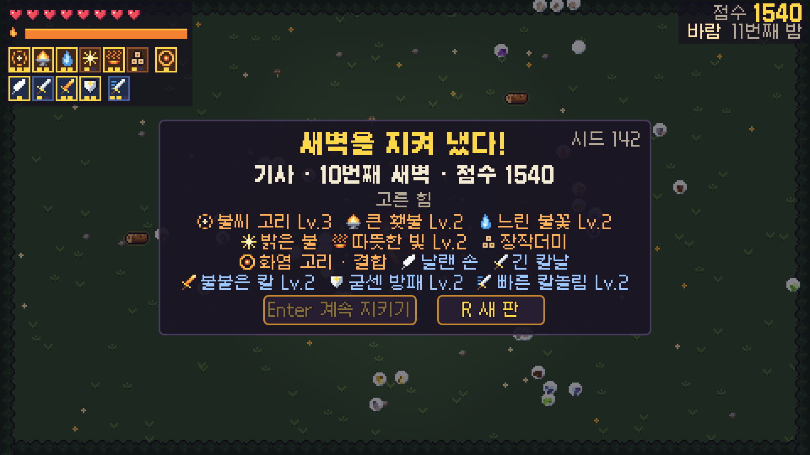
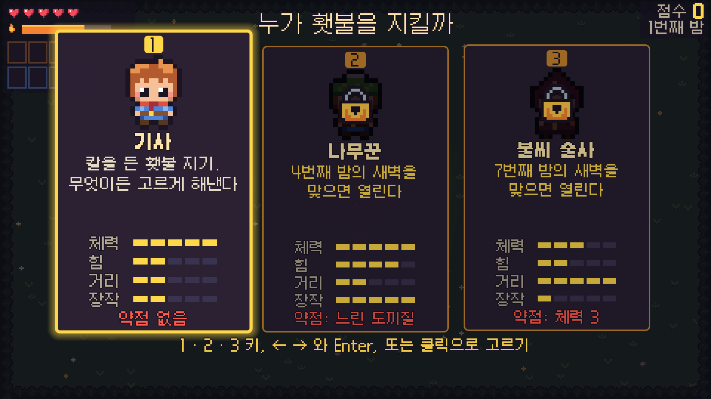
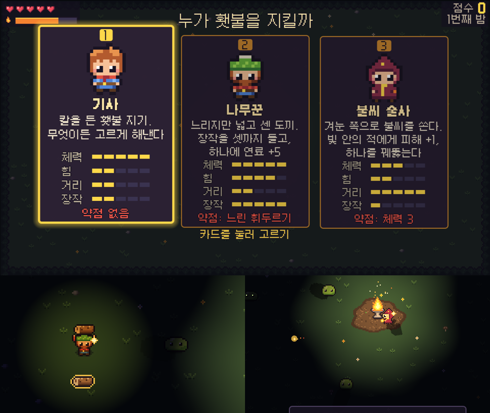
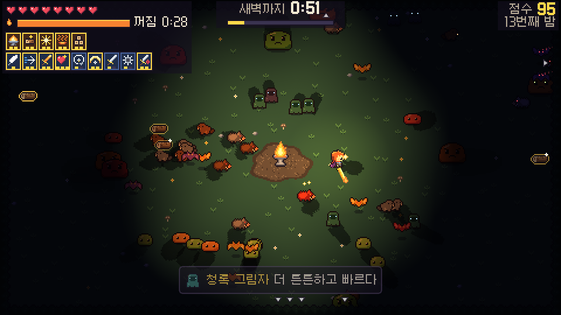
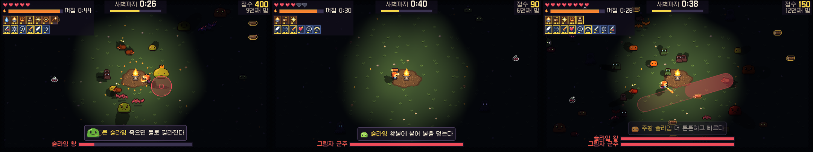

# 횃불 지기

밤마다 꺼져 가는 횃불을 지키는 상단 시점 생존 게임입니다. 장작을 주워 횃불에 넣고, 어둠에서 나오는 것들과 싸우세요.
새벽이 올 때마다 더 어려운 밤이 시작되고 새로운 적이 나옵니다. Godot 4 (GDScript)로 만들었습니다.


## 규칙

- 횃불은 계속 연료를 태웁니다. **연료가 0이 되거나 체력이 0이 되면** 끝입니다.
- 장작에 닿으면 줍습니다. 장작을 횃불에 가져가면 연료가 채워집니다. 장작을 든 동안은 느리고 벨 수 없습니다.
- 한 밤은 60초입니다. 새벽까지 버티면 점수 +100, 체력 +1을 받고 다음 밤으로 넘어갑니다.
- **10번째 새벽을 맞으면 이깁니다.** 첫 밤의 강화 화면이 "10번째 새벽까지 지키면 이긴다"고 알려 주고, 그 뒤 해 질 녘마다 "승리까지 N번"이 나옵니다. 밤 동안에는 위쪽 시계 아래에 새벽 수만큼 점이 줄지어 있습니다(맞은 새벽은 노랑, 오늘 밤은 주황, 마지막 점은 조금 큼). 이기면 그 판에서 얻은 것(캐릭터, 점수, 시드, 고른 힘)이 상자로 뜨고, **계속 지키기**(Enter·Space: 그 판이 지금까지처럼 끝없이 이어집니다)와 **새 판**(R: 그 판을 기록하고 새로 시작) 중에서 고릅니다. 상자가 떠 있는 동안 게임은 멈춰 있고, 뜬 뒤 1초는 키를 받지 않습니다. 계속하다가 진 판은 끝 화면에 "10번째 새벽을 지켜 낸 판"이라고 나옵니다. 이기든 말든 밤은 똑같습니다(적, 강화, 시드가 정하는 것 모두).
- **판에서 판으로 남는 것**(기록과 같은 파일 `user://records.json`에):
  - 캐릭터: 기사는 처음부터, 나무꾼은 누구로든 4번째 밤의 새벽을 처음 맞으면, 불씨 술사는 7번째 밤의 새벽을 처음 맞으면 열립니다. 잠긴 카드에는 자물쇠와 여는 조건이 적혀 있습니다. 이 판이 나오기 전에 기록을 하나라도 남긴 사람은 처음부터 셋 다 열려 있습니다.
  - 승리: 캐릭터마다 이긴 횟수가 고르기 화면의 카드(왕관과 ×N)와 끝 화면의 기록 아래("승리 기사 2 · 불씨 술사 1")에 나옵니다. 기록 목록에서 이긴 판에는 "승리"가 붙습니다.
  - **긴 밤**: 한 번이라도 이기면 고르기 화면 카드 아래에 단추가 생깁니다(L 키). 켜고 시작한 판은 15번째 새벽을 맞아야 이깁니다. 밤은 같고 목표만 멉니다.
  - 음악을 켰는지 껐는지.
- 몇 번째 밤까지 갔는지와 점수가 기록으로 남습니다(높은 점수 10개).




- 기사는 밤이 깊을수록 단단해집니다: 10번째 밤에 하트 3개, 12·14·16번째 밤에 하나씩 더(최대 6개 더), 10번째 밤부터는 새벽에 체력이 모두 회복되고, 맞은 뒤 무적 시간이 밤마다 0.15초씩 길어집니다(1.2초에서 최대 2.4초).
- 해 질 녘과 한밤중에 횃불이 강화 3개를 내밉니다. 1·2·3 키, ← → 와 Enter, 또는 클릭으로 하나를 고르세요(강화는 누구나 받는 18종, 캐릭터마다 자기만 받는 전용 2종, 둘을 함께 가지면 나오는 결합 4종입니다. 여러 번 골라 단계를 올릴 수 있는 것도 있습니다. 빠른 칼놀림은 10번째 밤부터만 나옵니다).
- **빌드는 고르는 것입니다.** 강화는 횃불의 힘 8종과 지키는 사람의 힘 10종(전용 2종을 더하면 12종)으로 나뉘고, 한 판에 가질 수 있는 서로 다른 강화는 횃불의 힘 6칸, 지키는 사람의 힘 4칸뿐입니다. 한쪽 칸이 다 차면 횃불은 그쪽의 새 강화를 더 내밀지 않고, 가진 강화의 다음 단계만 내밉니다. 빠른 칼놀림(10번째 밤부터)과 결합 강화는 칸을 쓰지 않습니다. 남은 칸은 왼쪽 위 HUD의 빈 타일과 일시정지 화면의 "2 / 6칸"으로 보입니다.
- **희귀** 카드(돌진, 회전 베기: 조작을 바꾸는 것)는 다른 카드의 절반만큼만 나옵니다. 보라색 테두리와 "희귀"로 표시됩니다.
- **전용** 강화는 그 캐릭터에게만 나옵니다(카드에 "전용"). 지키는 사람의 힘 칸을 하나 씁니다.
  - 기사: 굳센 방패(맞으면 무적이 0.6초/1초 길어지고, 30/42픽셀 안의 적을 밀쳐 내며 피해 1/2), 기세(적을 처치하면 3초/4초 동안 25%/40% 빨리 걷고 베기 간격이 30% 짧아짐).
  - 나무꾼: 쪼개기(도끼로 처치한 적이 8%/14% 확률로 그 자리에 장작을 남김), 큰 지게(장작을 하나 더 듦: 넷까지).
  - 불씨 술사: 꿰뚫는 불씨(불씨가 적 하나/둘을 더 꿰뚫고, 멈춘 자리뿐 아니라 꿰뚫는 적마다 터짐), 불씨 옮기기(불씨로 처치한 적이 40/64픽셀 안의 가장 가까운 적에게 작은 불씨(피해 1)를 튀김. 그 불씨로 처치한 적은 튀기지 않음).
- **결합** 강화는 정해진 두 강화를 둘 다 가졌을 때만 나옵니다. 칸을 쓰지 않고, 다른 카드보다 5배 자주 뽑혀서 짝을 맞추면 두세 번의 제안 안에 보입니다. 파란 테두리와 "결합"으로 표시됩니다. 재료가 되는 강화의 카드와 일시정지 화면의 줄에는 "+ 따뜻한 빛 = 화염 고리"처럼 무엇과 합쳐 무엇이 되는지 파란 글씨로 적혀 있습니다. 그 결합을 아직 이룰 수 있는 동안에만 적혀 있습니다: 결합을 얻었거나, 짝이 들어갈 칸이 남지 않았으면 사라집니다.
  - 불씨 고리 + 따뜻한 빛 = 화염 고리: 고리가 4초마다, 고리 안에서 체력이 1 남은 적을 마저 태웁니다(없으면 체력 1에서 멈춤). 보스는 태우지 못합니다.
  - 불씨 화살 + 불붙은 칼(도끼, 타오르는 불씨) = 불 표적: 지키는 사람의 공격이 빛 안의 적을 맞히면 횃불이 그 자리에서 불씨를 하나 쏩니다(1초에 한 번). 맞은 적이 살아 있으면 그 적에게, 그 공격에 죽었으면 불씨가 닿는 거리(204픽셀) 안에서 횃불에 가장 가까운 적에게 쏩니다(빛 밖이어도). 횃불이 제 간격으로 쏘는 불씨는 그대로 따로 나옵니다.
  - 돌진 + 가시 망토 = 가시 돌진: 돌진으로 스친 적마다 피해 2(돌진 한 번에 한 번씩).
  - 마른 장작 + 장작더미 = 장작 폭발: 장작을 횃불에 넣으면 횃불에서 40픽셀 안의 적이 밀려납니다(피해는 없음).
- **다시 뽑기**: 카드가 마음에 들지 않으면 R(또는 카드 아래 버튼)로 그 자리에서 다시 뽑습니다. 한 판에 2번뿐이고, 방금 본 카드는 다른 카드가 모자랄 때만 다시 나옵니다. 버튼에 남은 횟수가 적혀 있고, 다 쓰면 흐려집니다.
- 내밀 강화가 3개보다 적으면(칸이 다 차고 단계도 다 올렸으면) 빈자리는 **덤**으로 채워집니다: 불쏘시개(지금 연료 +30, 가득 차면 거기까지), 숨 고르기(지금 체력 1 회복), 마른 장작 하나(횃불 곁에 장작 하나), 밤의 이야기(지금 점수 +50). 덤은 한 번 쓰면 끝이고 칸을 쓰지 않습니다. 아무것도 주지 못할 덤은 나오지 않습니다: 숨 고르기는 다친 때에만 나옵니다. 나머지 셋은 늘 나올 수 있어서 제안은 언제나 카드 3장입니다.
- 2번째 밤부터는 밤마다 **징조**가 하나 붙어서 그 밤의 숫자를 바꿉니다(아래 "징조" 표). 해 질 녘 강화 카드 화면에 "오늘 밤 안개 빛이 좁아지고 박쥐가 몰려든다"처럼 이름과 뜻이 나오고, 밤 동안에는 오른쪽 위 "N번째 밤" 왼쪽에 이름이 보입니다. 같은 징조가 두 밤 이어지지는 않습니다. 첫 밤에는 징조가 없습니다.
- 판마다 다른 밤입니다. 판을 시작할 때마다 새 시드(1~999999)를 뽑아서, 횃불이 내미는 강화와 적이 나오는 자리·순서, 땅의 풀꽃이 판마다 다릅니다. 그 판의 시드는 일시정지 화면과 끝 화면의 상자 오른쪽 위 구석에 작게 나옵니다("시드 483920"). 끝 화면에서 **같은 시드로 다시**(T, 또는 그 단추)를 고르면 캐릭터 고르기 없이 같은 캐릭터, 같은 시드의 판이 바로 다시 시작됩니다: 첫 강화 카드부터 같습니다.
- 점수: 처치 10점, 장작 5점, 새벽 100점.

### 징조

| 징조 | 그 밤에 바뀌는 것 |
|---|---|
| 안개 (3번째 밤부터) | 횃불 빛 반경 −15%, 박쥐가 나오는 몫 2배 |
| 바람 (4번째 밤부터) | 연료가 20% 빨리 타고, 장작이 30% 짧은 간격으로 떨어집니다 |
| 고요 | 적이 10% 드물게 오고, 열매가 절반만큼만 납니다(첫 열매도 두 배 늦게: 한 밤에 하나쯤) |
| 풍년 | 장작 하나의 연료 +20%, 도둑 비버가 나오는 몫 3배 |
| 이슬 | 장작 하나의 연료 −25%, 열매가 두 배 자주 납니다 |
| 그믐 (4번째 밤부터) | 횃불 빛 반경 −5%, 그림자가 나오는 몫 1.6배 |
| 무더위 (3번째 밤부터) | 횃불 빛 반경 +8%, 불나방이 나오는 몫 2.5배 |

징조의 숫자는 강화와 곱해집니다(밝은 불 +30%에 안개면 1.3 × 0.85). 장작의 연료는 마른 장작·나무꾼의 덤까지 합친 것에 곱합니다.

### 캐릭터

판을 시작할 때(첫 화면 안내의 "시작" 뒤, 그리고 R이나 끝 화면을 눌러 다시 할 때마다) 횃불을 지킬 사람을 셋 중에서 고릅니다. 고르는 순간 그 판의 새 시드가 정해지고 판이 시작됩니다. 처음에는 기사만 열려 있고 나머지 둘은 새벽을 맞아 엽니다(위 "판에서 판으로 남는 것"). 지난번에 고른 카드에 초점이 가 있어서 Enter나 같은 카드를 누르면 바로 이어 갑니다. 카드를 누르거나 클릭, 1·2·3 키, ← → 와 Enter로 고릅니다(열린 뒤 0.6초는 누르는 것을 받지 않습니다).



| 캐릭터 | 공격 | 특징 | 약점 |
|---|---|---|---|
| 기사 | 칼: 0.28초마다 휘두르기, 피해 1 | 지금까지의 기사 그대로. 체력 5 | 없음 |
| 나무꾼 | 도끼: 0.38초마다 앞으로 내리찍기. 도끼를 머리 위로 들었다가 앞 19픽셀 자리에 찍어서, 반지름 14픽셀 원 안의 적에게 피해 2, 1.5배 더 밀어냄. 등 뒤·옆은 맞지 않음 | 장작을 셋까지 한꺼번에 들고(하나 더 들 때마다 조금 느려짐: 초당 70 → 64 → 58), 횃불에 넣으면 전부 들어갑니다. 장작 하나에 연료 +5. 도둑은 쌓인 장작 중 하나만 훔쳐 가고, 베기 키는 든 장작을 전부 내려놓으면서 바로 찍습니다 | 느린 도끼질(찍히는 순간이 0.13초 뒤), 뒤와 옆을 못 침 |
| 불씨 술사 | 불씨: 0.68초마다 겨눈 쪽(가장 가까운 적)으로 쏘기. 초당 200픽셀로 100픽셀까지 날아가 처음 닿은 적에게 피해 1. 멈춘 자리에서 터져 반경 16픽셀 안의 다른 적에게도 피해 1. 날아가는 불씨와 터짐은 둘레의 어둠을 밝힙니다(보는 데만 쓰이고, 빛 보너스는 횃불 빛에서만) | 횃불 빛 안의 적에게는 피해 +1, 그 적을 꿰뚫고 하나 더 맞힙니다(빛을 키우는 강화와 잘 맞습니다) | 체력 3, 장작을 들면 느림(초당 50) |

칼 강화는 캐릭터에 맞게 바뀝니다. 나무꾼에게는 긴 도끼자루(찍는 자리 +5/+9 앞으로)·넓게 찍기(찍는 원 반지름 +3/+5)·회전 도끼(몇 번째마다 한 바퀴를 휘두름)·불붙은 도끼·흡혈 도끼, 불씨 술사에게는 먼 불씨(날아가는 거리 +30/+50), 큰 불씨(맞히는 반경 +2/+3.5), 세 갈래 불씨(세 번째/두 번째 쏠 때마다 셋을 부채꼴로), 타오르는 불씨, 흡혈 불씨입니다. 10번째 밤부터는 공격 간격을 줄이는 강화도 나옵니다: 기사는 빠른 칼놀림, 나무꾼은 빠른 도끼질, 불씨 술사는 잦은 불씨. 단계마다 간격이 30% → 45% → 60%(불씨 술사는 20% → 35% → 50%) 짧아지고(맞는 때도 같은 비율로 당겨집니다), 마지막 단계에서는 닿는 거리(나무꾼은 가장 가까운 적 쪽으로 찍었을 때 그 원 안, 불씨 술사는 불씨가 날아가는 거리) 안에 적이 있으면 공격이 준비되는 대로 저절로 가장 가까운 적을 공격합니다. 닿는 적이 없으면 허공을 치지 않고, 장작을 든 동안에는 저절로 공격하지 않습니다(장작을 내려놓지 않게). 키로 공격해도 간격보다 빨라지지는 않습니다. 끝 화면과 최고 기록에 캐릭터 이름이 함께 나옵니다. 적 안내 글과 강화 줄 이름("나무꾼의 힘")도 고른 캐릭터의 이름으로 나옵니다(조사도 이름에 맞게: "나무꾼을", "불씨 술사를").

### 적

| 적 | 하는 일 |
|---|---|
| 슬라임 | 횃불에 붙어 불을 덮습니다(연료가 빨리 줄어듦) |
| 박쥐 | 기사를 쫓아옵니다. 횃불 빛 밖에서는 더 빠릅니다(눈이 빨갛게 탑니다) |
| 도둑 비버 | 장작을 물고 달아납니다. 닿아도 다치지 않습니다 |
| 그림자 | 횃불 빛 밖에서는 칼이 통하지 않습니다. 빛 안으로 끌어들이세요 |
| 큰 슬라임 | 느리고 단단합니다. 죽으면 슬라임 둘로 갈라집니다 |
| 멧돼지 | 기사를 쫓다가 멈춰 서서 발을 구르며 돌진할 길에 빨간 띠를 깔고, 띠가 차오르는 약 0.8초 뒤 그 띠를 따라 곧장 돌진합니다. 띠의 너비가 돌진에 맞는 너비라서 띠 밖에 서 있으면 안전합니다. 돌진이 끝나면 잠시 어지러워합니다(머리 위에 별). 그때 베세요 |
| 불나방 | 둘씩(7번째 밤부터 셋씩) 횃불로 빠르게 날아가 불꽃에 뛰어들어 타 버리면서 연료 5를 태워 없앱니다(장작 하나의 5분의 1). 불을 덮지도, 기사를 다치게 하지도 않습니다. 체력 1이라 한 번 베면 떨어지고, 닿기 전에 떨어진 불나방(칼, 불씨 화살, 화염 고리)은 아무것도 가져가지 못합니다. 등급이 올라도 체력 1과 연료 5는 그대로이고 빨라지기만 합니다. 어둠 속에서는 옅은 날개가 보입니다. 횃불에 닿기 전에 길목에서 베세요 |
| 독 두꺼비 | 기사를 쫓아오다 72픽셀 떨어진 곳에 멈춰 섭니다. 4초마다(뱉고 3.2초 쉰 뒤) 기사가 선 쪽으로 점선을 긋고 0.8초 동안 입가에 독을 부풀린 뒤, 그 점선을 따라 느린 독 방울(초당 75픽셀, 130픽셀까지)을 뱉습니다. 선은 부풀리기 시작할 때 정해지므로 옆으로 한 걸음 비키면 맞지 않습니다. 방울은 베면 터지고(불씨 술사의 불씨도 터뜨립니다), 필드 가장자리에서 사라집니다. 필드 밖에서는 뱉지 않습니다. 다가가서 베세요 |
| 북 도깨비 | 횃불 빛 가장자리 바로 밖에 서서 0.5초마다 북을 칩니다. 북소리가 닿는 64픽셀(노란 점선 원) 안의 다른 적은 30% 빨리 걷고, 그런 적 머리 위에는 노란 ≫ 표시가 뜁니다. 도깨비가 둘이어도 더 빨라지지는 않고, 도깨비가 쓰러지면 바로 원래 빠르기로 돌아옵니다. 제 몸은 약합니다(체력 2). 불을 떠나 먼저 찾아가 베세요 |

2번째 밤부터 도둑, 3번째 밤부터 그림자와 불나방, 4번째 밤부터 큰 슬라임, 5번째 밤부터 독 두꺼비, 6번째 밤부터 멧돼지, 7번째 밤부터 북 도깨비가 나옵니다. 새 적은 밤마다 오는 적의 수를 늘리지 않고 다른 적의 몫을 덜어서 나옵니다(불나방만 짝을 지어 와서 몸 수가 조금 늡니다). 7번째 밤부터는 적이 무리로도 옵니다: 도둑은 지켜 주는 그림자와, 멧돼지는 곁의 박쥐와 함께 같은 가장자리에서 나옵니다(9번째 밤에는 큰 슬라임이 멧돼지를 데려옵니다). 밤이 깊어질수록 적이 자주 오고 횃불이 빨리 타지만, 장작도 그만큼 자주 떨어집니다. 열매를 먹으면 체력이 1 회복됩니다.

5번째 밤부터는 같은 적이 더 센 등급으로도 나옵니다(5~7번째 밤에는 열에 하나쯤, 8번째 밤부터 더 자주). 색으로 구별합니다: 슬라임은 초록 → 주황 → 빨강, 박쥐는 보라 → 황금 → 빨강, 그림자는 보라 → 청록 → 빨강, 도둑 비버와 멧돼지는 갈색 → 잿빛 → 빨강, 불나방은 흰빛 → 노랑 → 빨강, 독 두꺼비는 파랑 → 보라 → 빨강, 북 도깨비는 노랑 → 파랑 → 빨강. 2등급은 체력 1.5배·10% 빠르고, 3등급(빨강)은 체력 2배·20% 빠르며 칼에 덜 밀립니다. 횃불을 덮는 힘과 처치 점수도 등급을 따라 커집니다(불나방만은 등급이 올라도 체력이 1입니다). 12번째 밤부터 빨간 적이 섞이고, 깊은 밤일수록 많아집니다. 보스는 등급이 없습니다.



화면 밖(가장자리 나무 그늘)에서 들어오는 적은 그쪽 가장자리의 작은 흰 화살표로 보입니다.

2번째 밤부터는 **떼**도 몰려옵니다. 한 종류(슬라임, 박쥐, 그림자, 도둑 비버, 멧돼지, 불나방 가운데 그 밤에 나오는 것. 그 밤에 많이 나오는 종류일수록 떼로도 자주 옵니다)가 같은 등급으로, 한 가장자리에서 10픽셀 간격으로 한 줄로 한꺼번에 나옵니다. 불나방 떼만 다릅니다: 많아야 6마리가 한 자리에서 0.5초 간격으로 한 마리씩 나오므로, 아무도 막지 않아도 잃는 연료는 2.5초에 걸쳐 30까지입니다. 오기 2.5초 전에 그 가장자리가 보스가 올 때처럼 빨갛게 깜빡이고 화면 아래에 "박쥐 떼가 몰려온다!"가 뜹니다. 2번째 밤에는 한 번(최대 3마리), 3번째 밤에는 한 번(최대 4마리), 4번째 밤부터 두 번(최대 8마리), 8번째 밤부터 세 번(최대 10마리)이고, 밤의 18초~54초 사이를 떼 수만큼 나눈 구간마다 하나씩 아무 때나 옵니다. 떼는 그 밤 적의 30%까지 차지하고, 그 수의 3/4만큼 평소에 하나씩 오는 적이 드물게 와서, 한 밤에 오는 적의 수는 전과 비슷합니다(많아야 8%쯤 더).

3번째 밤마다 보스가 옵니다: 3·6·9번째 밤에는 하나, 12·15·18번째 밤에는 둘, 21번째 밤부터는 셋. 보스는 셋이고, 어느 보스가 먼저 오는지는 판마다 다릅니다: 첫 보스 밤(3번째 밤)의 해 질 녘에 그 판의 차례가 정해지고, 그 뒤로는 그 차례대로 돌아가며 옵니다. 여럿일 때는 서로 다른 종류가 6초 간격으로 하나씩 옵니다. 각 보스가 오기 2초 전에 나타날 화면 가장자리가 빨갛게 깜빡이고 화살표가 그쪽을 가리킵니다(떼도 그렇습니다. 위쪽 가장자리에서 올 때는 화살표가 HUD 판 바로 아래로 내려와서 가려지지 않습니다). 첫 보스(3번째 밤)는 체력도 부르는 수도 절반이고(그림자 군주가 첫 보스일 때만 0.7배입니다: 절반으로는 다른 두 보스보다 훨씬 쉬웠습니다), 보스 밤이 지날수록 세집니다(밤마다 +20%, 최대 1.5배). 화면 아래에 보스마다 이름과 체력 막대가 쌓입니다.

| 보스 | 하는 일 |
|---|---|
| 슬라임 왕 | 횃불로 가며 슬라임을 부릅니다. 가까이 가면 기사가 선 자리에 빨간 원을 그리고 약 1초 뒤 그 위로 떨어집니다. 원 밖으로 피하세요. 두 번에 한 번은 크게 뛰는 대신 작은 원을 그리며 세 번 연달아 기사 쪽으로 깡충 뜁니다. 원마다 비키세요. 쓰러뜨리면 큰 슬라임으로 갈라집니다 |
| 멧돼지 대장 | 횃불이 아니라 기사를 쫓으며 멧돼지를 부릅니다. 4초쯤 걷다가 멈춰 서서 필드를 가로지르는 긴 띠(최대 260픽셀)를 깔고 1.1초 뒤 그 띠를 따라 돌진하기를 세 번 내리 합니다(돌진 사이에 0.5초 멈춰 다시 겨눕니다). 띠 밖으로 비키세요. 띠 위에 놓인 장작은 부서지지 않고 앞과 옆으로 밀려나고, 돌진에 받히면 들고 있던 장작을 띠 건너편에 떨어뜨립니다. 띠는 횃불 자리 앞에서 끊깁니다(횃불을 지나 돌진하지 않습니다). 횃불 자리에 서 있을 때 돌진할 차례가 오면 띠를 깔지 않고 먼저 불에서 곧장 걸어 나옵니다. 세 번째 돌진이 끝나면 3.5초 동안 숨을 몰아쉽니다(머리 위에 별, 코앞에 흰 김: 어둠 속에서도 보입니다). 그때 베세요 |
| 그림자 군주 | 횃불 빛 바로 밖을 돌며 그림자를 부릅니다. 어둠 속에서는 칼이 통하지 않습니다. 이따금 멈춰 횃불까지 점선을 긋고 1초 뒤 달려들어 잠시 불을 덮습니다. 빛 안에 있는 그때 베세요. 이따금 멈춰 깜빡이고 분신 둘을 만듭니다. 분신은 왕관이 없고 눈이 흐립니다(진짜는 파란 눈). 분신은 때리지도 불을 덮지도 않고, 군주가 달려들 때 같이 달려들다 횃불에서 흩어집니다. 빛 안에서 베면 흩어지지만 점수는 없습니다 |



## 조작

| 키 | 동작 |
|---|---|
| WASD / 방향키 | 이동 |
| Space / J / X | 베기, 불씨 술사는 쏘기 (장작을 들고 있으면 내려놓고 바로 공격) |
| Shift / K | 돌진 (돌진 강화가 있을 때. 다시 쓸 수 있을 때까지 기사 발밑에 막대가 차오릅니다) |
| 1 / 2 / 3 (또는 카드 클릭) | 캐릭터·강화 고르기 (← → 또는 A D로 카드를 옮기고 Enter·Space로도. 카드가 뜬 뒤 0.6초는 화살표와 Enter·Space를 받지 않습니다) |
| R | 강화 카드가 떠 있을 때: 카드 다시 뽑기 (한 판에 2번. 버튼처럼 카드가 뜬 뒤 0.6초는 받지 않습니다). 끝 화면에서: 다시 하기 (새 시드의 새 판). 승리 상자에서: 새 판 |
| T | 끝 화면에서: 같은 시드로 다시 (같은 캐릭터, 같은 시드) |
| Enter / Space | 승리 상자에서: 계속 지키기 |
| L | 캐릭터 고르기에서: 긴 밤 켜기·끄기 (한 번 이긴 뒤) |
| 마우스 왼쪽 클릭 | 끝 화면과 승리 상자의 두 단추 누르기 (단추 밖을 눌러서는 아무 일도 없습니다. 승리 상자는 뜬 뒤 1초부터) |
| M | 음악 켜기·끄기 (어느 화면에서나. 효과음은 그대로이고, 고른 것은 다음에 켤 때도 남습니다) |
| P / Esc | 일시정지 (쪽마다 찬 칸과 빈 칸, 가진 강화마다 한 줄씩 이름과 효과, 그 판의 시드) |
| H | 첫 화면의 안내 다시 보기 (게임을 열면 뜨는 세 쪽짜리 안내. ← → 로 넘기고 Enter 또는 Space로 시작) |

게임은 캐릭터 고르기, 그다음 강화 선택 화면에서 시작합니다. 먼저 1·2·3 중 하나를 눌러야 움직일 수 있습니다.

가진 강화는 왼쪽 위에 타일로 보입니다. 윗줄은 횃불의 힘(주황), 아랫줄은 기사의 힘(파랑)이고, 줄마다 칸 수만큼 자리가 있어서 아직 빈 칸은 속이 빈 타일로 보입니다(칸을 쓰지 않는 빠른 칼놀림과 결합 강화는 줄 끝에 조금 떨어져 붙습니다). 타일 아래 칸이 단계(채워진 금색 칸 = 지금 단계, 빈 칸 = 더 올릴 수 있는 단계)이며 마지막 단계면 테두리가 금색입니다. 이름과 효과는 고른 직후 위 가운데에 잠깐, 그리고 일시정지 화면과 끝 화면에 나옵니다. 땅에 떨어진 장작(금색 테두리)과 열매(흰 테두리)는 어둠 속에서도 테두리가 빛나고 가끔 반짝입니다. 횃불 빛 밖은 거의 캄캄합니다. 어둠 속의 적은 눈빛으로만 보이고, 빛 안에서는 모두 횃불 반대쪽으로 긴 그림자를 드리웁니다. 기사는 횃불에 닿으면 불씨를 붙여 갑니다. 불씨는 빛 밖에서 10초쯤에 걸쳐 식으면서 보이는 범위가 줄고, 횃불에 다시 닿아야 살아납니다(보는 데만 쓰이고, 적에게는 횃불 빛만 빛입니다).

## 실행

[Godot 4.7](https://godotengine.org/download)이 필요합니다. Windows에서는 이렇게 설치할 수 있습니다.

```
winget install GodotEngine.GodotEngine
```

```
godot --path .                    # 게임 실행
godot -e --path .                 # 에디터로 열기
godot --path . -- --bot           # 봇이 플레이하는 것 보기 (시드 1, --seed=N을 주면 그 시드)
godot --path . -- --seed=4        # 판마다 새 시드를 뽑는 대신 늘 그 시드(1~999999)의 밤으로
godot --path . -- --bot --skip=19000  # 봇이 먼저 그만큼(스텝) 플레이한 뒤부터 보기
godot --path . -- --bot --slot=2  # 봇이 늘 고르는 강화 칸
godot --path . -- --char=mage     # 캐릭터 고르기 없이 그 캐릭터로 (knight, woodcutter, mage; 봇과 함께도)
godot --path . -- --flat          # 땅을 크레용 결 없이 예전의 단색으로 (비교용)
godot --path . -- --bot --goal=1  # 이기는 새벽을 옮겨서 승리 상자 보기 (이런 판은 아무것도 저장하지 않습니다)
godot --headless --path . --script res://tools/music_wav.gd -- /tmp/music  # 음악을 WAV로 저장하고 길이·크기·만드는 시간을 출력
```

`--char=ID`와 봇은 잠긴 캐릭터도 그대로 씁니다. 봇의 판, 화면 없는 실행(`--headless`), `--goal`·`--night`·`--crowd`로 연 판은 기록·열린 캐릭터·음악 설정을 저장하지 않습니다.

### 음악

음악도 효과음처럼 코드로 만듭니다(`src/audio/music.gd`: 음표를 적은 표를 시작할 때 한 번 샘플로 굽습니다. 오디오 파일은 없습니다). 세 가지가 1.2초에 걸쳐 서로 바뀝니다: 해 질 녘·캐릭터 고르기·첫 화면·끝 화면의 잔잔한 곡, 밤의 박동, 보스가 필드에 있는 동안의 무거운 곡. 밤과 보스 곡 위에는 **횃불이 꺼지기까지 20초 아래로 내려가면** 반 박자 사이를 메우는 겹이 점점 커져서(6초 남았을 때 전부) 박동이 두 배로 조여듭니다. 새벽과 승리에는 짧은 가락이 한 번 울립니다. 보스·떼의 예고, 보스의 등장, 보스의 공격 예고가 울리면 음악이 0.9초 동안 30%로 물러납니다. 웹에서는 브라우저가 첫 입력 전의 소리를 막으므로 첫 키·터치 뒤에 시작합니다.

판이 시작될 때마다 콘솔에 `run: seed <시드>, <캐릭터>` 한 줄이 찍힙니다. 그 밤을 다시 보려면 그 시드를 `--seed=`에 주세요.

## 웹/모바일

휴대폰이나 PC 브라우저에서 바로 할 수 있습니다: **https://khwook.github.io/2dgame1/** (GitHub Pages, `main`에 올라갈 때마다 다시 빌드). 휴대폰은 가로로 들고 하세요. 세로로 들면 게임이 멈추고 "가로로 돌려 주세요"가 뜹니다. 안드로이드 브라우저에서는 첫 화면 안내의 "시작"을 누르면 전체 화면으로 바뀝니다(아이폰 Safari는 웹 페이지의 전체 화면을 지원하지 않아서 그대로입니다. 공유 → "홈 화면에 추가"로 열면 주소창 없이 열립니다).


| 터치 | 동작 |
|---|---|
| 화면 왼쪽 아무 데나 누르고 끌기 | 이동 (손가락이 닿은 자리에 조이스틱이 나타납니다. 민 방향 그대로, 조금만 밀어도 제 속도로 걷습니다) |
| 오른쪽 아래 큰 칼 버튼, 또는 화면 오른쪽 아무 데나 | 베기 (장작을 들고 있으면 내려놓고 바로 공격). 이동하면서 같이 누를 수 있습니다 |
| 칼 버튼 왼쪽 버튼 | 돌진 (돌진 강화를 얻은 뒤에만 보입니다) |
| 오른쪽 위 ‖ 버튼 | 일시정지. 아무 데나 누르면 계속 |
| 그 왼쪽 ? 버튼 | 첫 화면(설명) 다시 보기. 일시정지 화면에서도 됩니다 (키보드의 H) |
| 첫 화면 안내 | 아무 데나 누르거나 옆으로 밀어 넘기고, 마지막 쪽의 "시작"으로 시작 (한 번 읽은 뒤에는 첫 쪽에도 "시작"). 열린 뒤 1초는 누르는 것을 받지 않습니다 |
| ? 버튼 왼쪽 ♪ 버튼 | 음악 켜기·끄기. 일시정지 화면에서도 됩니다 (키보드의 M). 꺼져 있으면 빨간 줄이 그어집니다 |
| 끝 화면의 "같은 시드로 다시" 단추 | 같은 캐릭터, 같은 시드로 다시 |
| 끝 화면의 다른 곳 누르기 | 다시 하기 |
| 승리 상자의 "계속 지키기" / "새 판" 단추 | 그대로 (다른 곳을 눌러서는 닫히지 않습니다) |
| 캐릭터 고르기의 "긴 밤" 단추 | 긴 밤 켜기·끄기 (한 번 이긴 뒤에 보입니다) |
| 카드 누르기 | 캐릭터·강화 고르기 |
| 강화 카드 아래 "다시 뽑기" 버튼 | 카드 다시 뽑기 (남은 횟수가 적혀 있습니다. 카드 아래로 한 줄 떨어져 있고, 카드가 뜬 뒤 0.6초는 받지 않습니다) |

터치 버튼은 화면을 처음 만졌을 때(또는 터치 화면이 있는 기기에서) 나타나고, 키보드를 누르면 사라집니다. 웹에서도 키보드로 할 수 있습니다.

배포를 켜려면 저장소 주인이 한 번 **Settings → Pages → Source: GitHub Actions**로 바꿔야 합니다(`.github/workflows/pages.yml`). 비공개 저장소의 Pages는 유료 요금제(Pro, Team 등)에서만 됩니다. 워크플로는 Godot 4.7과 웹 템플릿을 받아 `./verify`를 돌리고, 통과하면 내보내서 올립니다.

직접 웹으로 내보내기(Godot 4.7 내보내기 템플릿 필요, 에디터의 Editor → Manage Export Templates 또는 [릴리스](https://github.com/godotengine/godot/releases/tag/4.7-stable)의 `.tpz`):

```
mkdir -p build/web && touch build/.gdignore
godot --headless --path . --export-release "Web" build/web/index.html
python3 -m http.server 8000 --directory build/web   # http://localhost:8000
```

내보낸 판은 스레드를 쓰지 않는 판이라 특별한 서버 헤더(COOP/COEP) 없이 어느 정적 호스팅에서도 돕니다.

## 개발

```
./verify                  # 규칙 검사 + 자체 테스트 + 리플레이 (통과해야 완료)
./verify --balance        # 봇이 시드 20개에서 몇 번째 밤에 지는지 (--late: 10번째 밤부터, --char=ID 또는 --char=all)
./verify --variety        # 판끼리, 빌드끼리(캐릭터마다 한 줄), 밤의 박자가 얼마나 닮았는지
./verify --update-golden  # 게임플레이를 일부러 바꿨을 때 골든 리플레이 다시 기록
```

- `src/sim/` — 시뮬레이션. 엔진과 분리된 순수 데이터라서 결정론적이고 헤드리스로 리플레이됩니다. 적·강화·밤 표는 `config.gd`에 있습니다.
- `src/art/` — 그림. 스프라이트는 `sprites.gd` 안의 글자 격자(글자 하나 = 픽셀 하나)이고, `painter.gd`가 월드를 읽어 그립니다. 땅만은 픽셀 아트가 아닙니다: `ground.gdshader`가 풀밭과 횃불 둘레의 맨땅을 종이에 크레용으로 칠한 듯한 비스듬한 결로 그립니다(결의 너비는 게임 픽셀 하나, 알갱이는 화면 픽셀 하나). 캐릭터·적·HUD·글자는 픽셀 아트 그대로입니다.
- `src/main.gd` — 엔진과 시뮬레이션 사이의 유일한 다리(입력, 스텝, 빛, 소리).
- `src/ui.gd` — 화면의 모든 글자와 그 움직임(HUD 글자, 강화 카드, 안내, 일시정지·끝 화면).
- `src/touch.gd` — 휴대폰의 조이스틱과 버튼. 터치를 키와 같은 동작 이름으로 바꿉니다.
- `src/records.gd` — 판에서 판으로 남는 것 전부를 읽고 씁니다: 기록·열린 캐릭터·승리 수·음악 설정은 `records.json`에(옆에 다 쓴 뒤 이름을 바꿔 덮으므로 쓰다 끊겨도 반쪽 파일이 남지 않습니다), 안내를 읽었는지는 `guide.json`에, 마지막에 고른 캐릭터는 `character.json`에. 읽지 못하는 파일은 덮어쓰지 않고 옆에 `records.unread.json`으로 옮겨 둡니다.
- `src/audio/` — 코드로 만드는 소리: 효과음(`sfx.gd`)과 음악(`music.gd`).
- `assets/fonts/` — 한글 픽셀 폰트 [Galmuri](https://github.com/quiple/galmuri)(SIL OFL 1.1, 한글에 필요한 글자만 잘라 넣음). 저장소의 유일한 바이너리 에셋입니다.
- `tools/` — 검사 도구. 각 규칙 id의 설명은 [docs/PRINCIPLES.md](docs/PRINCIPLES.md)에 있습니다.
- 결정과 그 이유는 [docs/DECISIONS.md](docs/DECISIONS.md)에 기록합니다.
