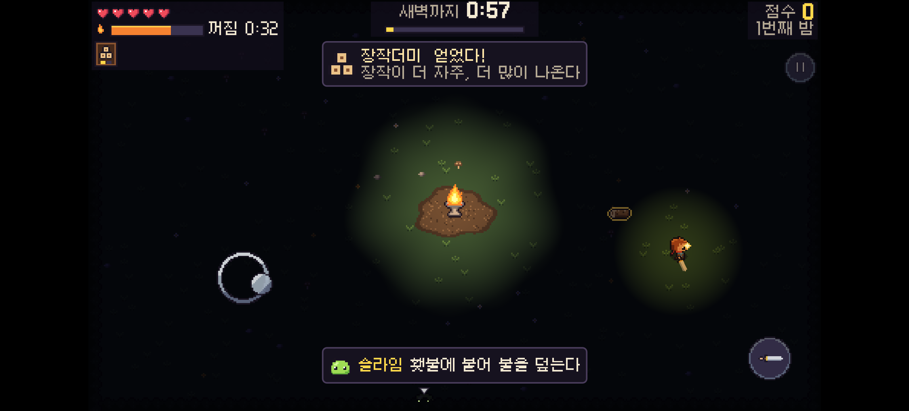

# 횃불 지기

밤마다 꺼져 가는 횃불을 지키는 상단 시점 생존 게임입니다. 장작을 주워 횃불에 넣고, 어둠에서 나오는 것들과 싸우세요.
새벽이 올 때마다 더 어려운 밤이 시작되고 새로운 적이 나옵니다. Godot 4 (GDScript)로 만들었습니다.


## 규칙

- 횃불은 계속 연료를 태웁니다. **연료가 0이 되거나 체력이 0이 되면** 끝입니다.
- 장작에 닿으면 줍습니다. 장작을 횃불에 가져가면 연료가 채워집니다. 장작을 든 동안은 느리고 벨 수 없습니다.
- 한 밤은 60초입니다. 새벽까지 버티면 점수 +100, 체력 +1을 받고 다음 밤으로 넘어갑니다. 승리는 없습니다. 몇 번째 밤까지 갔는지와 점수가 결과입니다.
- 해 질 녘과 한밤중에 횃불이 강화 3개를 내밉니다. 1·2·3 중 하나를 고르세요(강화는 17종, 여러 번 골라 단계를 올릴 수 있는 것도 있습니다).
- 점수: 처치 10점, 장작 5점, 새벽 100점.

### 적

| 적 | 하는 일 |
|---|---|
| 슬라임 | 횃불에 붙어 불을 덮습니다(연료가 빨리 줄어듦) |
| 박쥐 | 기사를 쫓아옵니다. 횃불 빛 밖에서는 더 빠릅니다(눈이 빨갛게 탑니다) |
| 도둑 비버 | 장작을 물고 달아납니다. 닿아도 다치지 않습니다 |
| 그림자 | 횃불 빛 밖에서는 칼이 통하지 않습니다. 빛 안으로 끌어들이세요 |
| 큰 슬라임 | 느리고 단단합니다. 죽으면 슬라임 둘로 갈라집니다 |
| 멧돼지 | 기사를 쫓다가 멈춰 서서 발을 구르며 빨간 점선을 긋고, 약 0.8초 뒤 그 선을 따라 곧장 돌진합니다. 옆으로 비키세요. 돌진이 끝나면 잠시 어지러워합니다(머리 위에 별). 그때 베세요 |

2번째 밤부터 도둑, 3번째 밤부터 그림자, 4번째 밤부터 큰 슬라임, 6번째 밤부터 멧돼지가 나옵니다. 7번째 밤부터는 적이 무리로도 옵니다: 도둑은 지켜 주는 그림자와, 멧돼지는 곁의 박쥐와 함께 같은 가장자리에서 나옵니다(9번째 밤에는 큰 슬라임이 멧돼지를 데려옵니다). 밤이 깊어질수록 적이 자주 오고 횃불이 빨리 타지만, 장작도 그만큼 자주 떨어집니다. 열매를 먹으면 체력이 1 회복됩니다.

화면 밖(가장자리 나무 그늘)에서 들어오는 적은 그쪽 가장자리의 작은 흰 화살표로 보입니다.

5번째 밤마다 보스가 옵니다. 오기 2초 전에 나타날 화면 가장자리가 빨갛게 깜빡입니다.

| 보스 | 하는 일 |
|---|---|
| 슬라임 왕 (5, 15, ...번째 밤) | 횃불로 가며 슬라임을 부릅니다. 가까이 가면 기사가 선 자리에 빨간 원을 그리고 약 1초 뒤 그 위로 떨어집니다. 원 밖으로 피하세요. 쓰러뜨리면 큰 슬라임 둘로 갈라집니다 |
| 그림자 군주 (10, 20, ...번째 밤) | 횃불 빛 바로 밖을 돌며 그림자를 부릅니다. 어둠 속에서는 칼이 통하지 않습니다. 이따금 멈춰 횃불까지 점선을 긋고 1초 뒤 달려들어 잠시 불을 덮습니다. 빛 안에 있는 그때 베세요 |

## 조작

| 키 | 동작 |
|---|---|
| WASD / 방향키 | 이동 |
| Space / J / X | 베기 (장작을 들고 있으면 내려놓기) |
| Shift / K | 돌진 (돌진 강화가 있을 때. 다시 쓸 수 있을 때까지 기사 발밑에 막대가 차오릅니다) |
| 1 / 2 / 3 (또는 카드 클릭) | 강화 고르기 |
| R | 다시 하기 |
| P / Esc | 일시정지 (가진 강화의 이름과 효과 목록) |
| H | 첫 화면의 설명 다시 보기 (게임을 열면 한 번 뜨고, 아무 키로 닫습니다) |

게임은 강화 선택 화면에서 시작합니다. 먼저 1·2·3 중 하나를 눌러야 움직일 수 있습니다.

가진 강화는 왼쪽 위에 타일로 보입니다. 윗줄은 횃불의 힘(주황), 아랫줄은 기사의 힘(파랑)이고, 타일 아래 칸이 단계(채워진 금색 칸 = 지금 단계, 빈 칸 = 더 올릴 수 있는 단계)이며 마지막 단계면 테두리가 금색입니다. 이름과 효과는 고른 직후 위 가운데에 잠깐, 그리고 일시정지 화면과 끝 화면에 나옵니다. 땅에 떨어진 장작(금색 테두리)과 열매(흰 테두리)는 어둠 속에서도 테두리가 빛나고 가끔 반짝입니다. 횃불 빛 밖은 거의 캄캄합니다. 어둠 속의 적은 눈빛으로만 보이고, 빛 안에서는 모두 횃불 반대쪽으로 긴 그림자를 드리웁니다. 기사는 횃불에 닿으면 불씨를 붙여 갑니다. 불씨는 빛 밖에서 10초쯤에 걸쳐 식으면서 보이는 범위가 줄고, 횃불에 다시 닿아야 살아납니다(보는 데만 쓰이고, 적에게는 횃불 빛만 빛입니다).

## 실행

[Godot 4.7](https://godotengine.org/download)이 필요합니다. Windows에서는 이렇게 설치할 수 있습니다.

```
winget install GodotEngine.GodotEngine
```

```
godot --path .                    # 게임 실행
godot -e --path .                 # 에디터로 열기
godot --path . -- --bot           # 봇이 플레이하는 것 보기
godot --path . -- --seed=4        # 다른 밤(시드)으로 시작
godot --path . -- --bot --skip=19000  # 봇이 먼저 그만큼(스텝) 플레이한 뒤부터 보기
godot --path . -- --bot --slot=2  # 봇이 늘 고르는 강화 칸
```

## 웹/모바일

휴대폰이나 PC 브라우저에서 바로 할 수 있습니다: **https://khwook.github.io/2dgame1/** (GitHub Pages, `main`에 올라갈 때마다 다시 빌드). 휴대폰은 가로로 들고 하세요. 세로로 들면 게임이 멈추고 "가로로 돌려 주세요"가 뜹니다. 안드로이드 브라우저에서는 첫 화면을 누르면 전체 화면으로 바뀝니다(아이폰 Safari는 웹 페이지의 전체 화면을 지원하지 않아서 그대로입니다. 공유 → "홈 화면에 추가"로 열면 주소창 없이 열립니다).



| 터치 | 동작 |
|---|---|
| 화면 왼쪽 아무 데나 누르고 끌기 | 이동 (손가락이 닿은 자리에 조이스틱이 나타납니다. 8방향) |
| 오른쪽 아래 칼 버튼 | 베기 (장작을 들고 있으면 내려놓기). 이동하면서 같이 누를 수 있습니다 |
| 칼 버튼 왼쪽 작은 버튼 | 돌진 (돌진 강화를 얻은 뒤에만 보입니다) |
| 오른쪽 위 ‖ 버튼 | 일시정지. 아무 데나 누르면 계속 |
| 그 왼쪽 ? 버튼 | 첫 화면(설명) 다시 보기. 일시정지 화면에서도 됩니다 (키보드의 H) |
| 첫 화면, 끝 화면을 누르기 | 시작, 다시 하기 |
| 카드 누르기 | 강화 고르기 |

터치 버튼은 화면을 처음 만졌을 때(또는 터치 화면이 있는 기기에서) 나타나고, 키보드를 누르면 사라집니다. 웹에서도 키보드로 할 수 있습니다.

배포를 켜려면 저장소 주인이 한 번 **Settings → Pages → Source: GitHub Actions**로 바꿔야 합니다(`.github/workflows/pages.yml`). 비공개 저장소의 Pages는 유료 요금제(Pro, Team 등)에서만 됩니다. 워크플로는 Godot 4.7과 웹 템플릿을 받아 `./verify`를 돌리고, 통과하면 내보내서 올립니다.

직접 웹으로 내보내기(Godot 4.7 내보내기 템플릿 필요, 에디터의 Editor → Manage Export Templates 또는 [릴리스](https://github.com/godotengine/godot/releases/tag/4.7-stable)의 `.tpz`):

```
mkdir -p build/web && touch build/.gdignore
godot --headless --path . --export-release "Web" build/web/index.html
python3 -m http.server 8000 --directory build/web   # http://localhost:8000
```

내보낸 판은 스레드를 쓰지 않는 판이라 특별한 서버 헤더(COOP/COEP) 없이 어느 정적 호스팅에서도 돕니다.

## 개발

```
./verify                  # 규칙 검사 + 자체 테스트 + 리플레이 (통과해야 완료)
./verify --balance        # 봇이 시드 20개에서 몇 번째 밤에 지는지
./verify --update-golden  # 게임플레이를 일부러 바꿨을 때 골든 리플레이 다시 기록
```

- `src/sim/` — 시뮬레이션. 엔진과 분리된 순수 데이터라서 결정론적이고 헤드리스로 리플레이됩니다. 적·강화·밤 표는 `config.gd`에 있습니다.
- `src/art/` — 그림. 스프라이트는 `sprites.gd` 안의 글자 격자(글자 하나 = 픽셀 하나)이고, `painter.gd`가 월드를 읽어 그립니다.
- `src/main.gd` — 엔진과 시뮬레이션 사이의 유일한 다리(입력, 스텝, 빛, 소리).
- `src/ui.gd` — 화면의 모든 글자와 그 움직임(HUD 글자, 강화 카드, 안내, 일시정지·끝 화면).
- `src/touch.gd` — 휴대폰의 조이스틱과 버튼. 터치를 키와 같은 동작 이름으로 바꿉니다.
- `assets/fonts/` — 한글 픽셀 폰트 [Galmuri](https://github.com/quiple/galmuri)(SIL OFL 1.1, 한글에 필요한 글자만 잘라 넣음). 저장소의 유일한 바이너리 에셋입니다.
- `tools/` — 검사 도구. 각 규칙 id의 설명은 [docs/PRINCIPLES.md](docs/PRINCIPLES.md)에 있습니다.
- 결정과 그 이유는 [docs/DECISIONS.md](docs/DECISIONS.md)에 기록합니다.
